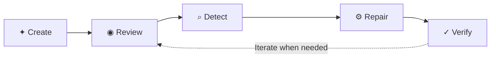

<!--
  UI-Forge — Build better interfaces with AI, verify them with evidence.
-->

<div align="center">

# ⚒️ UI-Forge

### Forge interfaces. Inspect every detail. Ship with confidence.

**A portable UI engineering toolkit for AI coding agents — built for creating polished frontends, reviewing visual quality, detecting real defects, and applying carefully approved fixes.**

<br/>

[](https://github.com/Quincunx33/UI-Forge)
[](https://nodejs.org/)
[](https://playwright.dev/)
[](https://github.com/Quincunx33/UI-Forge)

<br/>

[Explore the Repository](https://github.com/Quincunx33/UI-Forge) · [Quick Start](#-quick-start) · [Documentation](#-documentation) · [Roadmap](ROADMAP.md)

</div>

---

## ✨ What is UI-Forge?

UI-Forge gives AI coding agents a structured workflow for frontend engineering. It combines **portable agent skills** with a lightweight **Node.js CLI** so an agent can create an interface while repeatable browser checks gather evidence about how that interface actually behaves.

It is not another AI model, website builder, or automatic redesign button. Your connected coding agent does the reasoning and implementation; UI-Forge supplies the workflow, guardrails, browser audits, and repair handoff.

> **The goal:** beautiful interfaces are important. Verified, usable, responsive interfaces are better.

## 🔥 The workflow

<div align="center">



</div>

| Skill | Purpose | Edits source files? |
|:--|:--|:--:|
| `ui-create` | Create a new frontend or deliver a substantial redesign | When requested |
| `ui-design-review` | Evaluate visual hierarchy, UX, responsiveness, and accessibility | No |
| `ui-detect` | Find and document reproducible UI defects | No |
| `ui-repair` | Fix confirmed defects with the smallest safe change | Only when explicitly requested |
| `ui-forge` | Coordinate the complete workflow across supported AI hosts | Depends on selected mode |

## 💎 What makes it useful?

- **Creation-first workflow** — build new interfaces and substantial redesigns, not just patch existing code.
- **Agent-portable skills** — install project instructions for Codex, Claude Code, Cursor, and compatible agents.
- **Real browser evidence** — inspect rendered pages at configured routes and viewport sizes.
- **Responsive checks** — detect overflow, clipping, navigation failures, and other layout problems.
- **Accessibility signals** — integrate axe-core checks and basic keyboard/focus smoke tests.
- **Visual regression** — compare against manually approved screenshot baselines.
- **Controlled repair** — review a patch and explicitly approve its exact file scope before applying it.
- **Safety by default** — detection is read-only; optional interactions are opt-in and restricted to marked safe controls.

## 🚀 Quick start

### 1. Requirements

- Node.js **20 or newer**
- npm
- An AI coding agent that can read project instructions
- Chromium for browser-based audits

### 2. Install UI-Forge

```bash
git clone https://github.com/Quincunx33/UI-Forge.git
cd UI-Forge
npm install
npx playwright install chromium
```

### 3. Install the skills in your project

Run this from the UI-Forge repository. Replace the target path with your own project directory.

```bash
node ./bin/ui-forge.js install --agent all --target /path/to/your-project
```

Or install for one agent:

```bash
# OpenAI Codex
node ./bin/ui-forge.js install --agent codex --target /path/to/your-project

# Claude Code
node ./bin/ui-forge.js install --agent claude --target /path/to/your-project

# Cursor
node ./bin/ui-forge.js install --agent cursor --target /path/to/your-project
```

The installer adds project-level skill directories:

```text
your-project/
├── .agents/skills/       # Codex and compatible agents
├── .claude/skills/       # Claude Code
└── .cursor/skills/       # Cursor
```

Project installation is the default. Use `--scope user` for a user-level installation. Existing skill folders are not overwritten unless you explicitly pass `--force`.

### 4. Start building

Open the target project in your AI coding agent and try:

```text
Use the UI-Forge ui-create workflow.

Build a polished, responsive SaaS dashboard with a clean visual
system, thoughtful spacing, accessible navigation, useful empty
states, and fully working interactions.

Preserve the project's existing stack and conventions.
Inspect the rendered interface at mobile and desktop sizes,
then run the available checks before finishing.
```

**Important:** frontend creation is performed by your AI coding agent using the `ui-create` skill. The CLI installs skills and runs audits; there is no `ui-forge create` command.

## 🧪 Browser audit

UI-Forge's detector runs against an application that you start separately.

### 1. Start your app

```bash
cd /path/to/your-project
npm run dev
```

### 2. Add a configuration file

Copy `ui-forge.config.example.json` from this repository into your project and adjust it:

```json
{
  "baseUrl": "http://127.0.0.1:3000",
  "routes": ["/", "/projects"],
  "viewports": [
    { "name": "mobile", "width": 390, "height": 844 },
    { "name": "desktop", "width": 1440, "height": 900 }
  ],
  "mode": "detect",
  "outputDir": ".ui-forge",
  "browser": {
    "engine": "chromium",
    "headless": true,
    "navigationTimeoutMs": 30000
  },
  "allowRemote": false
}
```

### 3. Run the audit

```bash
node /path/to/UI-Forge/bin/ui-forge.js detect \
  --config ./ui-forge.config.json
```

Reports and screenshots are saved in a timestamped run directory:

```text
.ui-forge/
└── <run-id>/
    ├── report.json
    └── screenshots/
```

### What can it inspect?

| Area | Examples |
|:--|:--|
| Navigation | Route responses, failed navigation, same-origin route discovery |
| Runtime | Console errors, uncaught exceptions, failed requests |
| Layout | Responsive overflow and clipped content |
| Accessibility | axe-core findings and basic keyboard/focus checks |
| Motion | Reduced-motion behavior |
| Visuals | Screenshot comparison against approved baselines |
| Performance | Selected lab signals and layout-shift smoke checks |

These checks provide useful evidence, not a guarantee of complete WCAG conformance or production performance. Unsupported checks are reported as `untested`.

## 🛡️ Controlled repair

UI-Forge separates **finding a problem** from **changing project files**.

```bash
# 1. Create a handoff from a verified finding
node /path/to/UI-Forge/bin/ui-forge.js handoff \
  --report .ui-forge/<run-id>/report.json \
  --finding UIF-0001 \
  --out finding.handoff.json

# 2. Review the proposed patch
node /path/to/UI-Forge/bin/ui-forge.js review \
  --handoff finding.handoff.json \
  --patch proposed.patch

# 3. Apply only after reviewing and approving the exact scope
node /path/to/UI-Forge/bin/ui-forge.js apply \
  --handoff finding.handoff.json \
  --patch proposed.patch \
  --root /path/to/your-project \
  --approve \
  --apply
```

Applying a patch requires a clean Git working tree, an exact allowed-file list, explicit approval, symlink checks, and a successful `git apply --check`.

The patch adapter is a Git guard — **not an OS-level sandbox**. Always review proposed changes before applying them.

## 🎛️ Optional interaction checks

Interaction testing is opt-in. Only project-owned, side-effect-safe buttons explicitly marked with `data-ui-forge-safe="true"` are eligible.

```html
<button
  type="button"
  data-testid="open-settings"
  data-ui-forge-safe="true">
  Open settings
</button>
```

```json
{
  "interactions": [
    {
      "name": "open-settings-panel",
      "testId": "open-settings",
      "route": "/",
      "expectedText": "Settings"
    }
  ]
}
```

Forms are not submitted, and unmarked controls are not clicked.

## 🧰 CLI commands

```text
ui-forge install --agent <codex|claude|cursor|all> [--scope project|user] [--target <dir>] [--force]
ui-forge detect --config <file>
ui-forge handoff --report <report.json> --finding <UIF-ID> [--out <file>]
ui-forge review --handoff <file> --patch <diff.patch> [--approve]
ui-forge apply --handoff <file> --patch <diff.patch> --root <repo> --approve --apply
```

## ✅ Verify the toolkit

From the repository root:

```bash
npm install
npx playwright install chromium
npm test
npm run check
npm run test:browser
```

The current quality gate includes unit, schema, installer, repair, patch-review, patch-apply, and browser integration tests.

## 📚 Documentation

| Guide | What you'll find |
|:--|:--|
| [Plugin usage](docs/PLUGIN-USAGE.md) | Using UI-Forge skills and workflows |
| [Universal AI agent setup](docs/UNIVERSAL-AGENT-SETUP.md) | Agent installation and setup |
| [Quality gates](docs/QUALITY-GATES.md) | Validation and testing strategy |
| [Architecture](docs/ARCHITECTURE.md) | How the toolkit is structured |
| [Threat model](docs/THREAT-MODEL.md) | Security boundaries and safeguards |
| [Roadmap](ROADMAP.md) | Planned work and project direction |

## ⚠️ Safety & limitations

- Use browser audits only on systems you own or are authorized to test.
- Loopback targets are the default; remote targets require explicit `allowRemote: true`.
- Known cloud metadata hosts, embedded URL credentials, and cross-origin route escapes are blocked.
- Detection does not modify project source files.
- Browser automation and automated accessibility checks are not substitutes for manual review, assistive-technology testing, exhaustive keyboard testing, or real-world performance profiling.

## 🤝 Contributing

Ideas, bug reports, and improvements are welcome. Please open an issue with clear reproduction steps or submit a focused pull request.

## 📄 License

This repository currently declares **UNLICENSED** in `package.json`. No open-source reuse permissions are implied.

---

<div align="center">

### Built to help AI agents craft better interfaces.

**UI-Forge** · Create thoughtfully. Review carefully. Repair responsibly.

[⬆ Back to top](#️-ui-forge)

</div>
